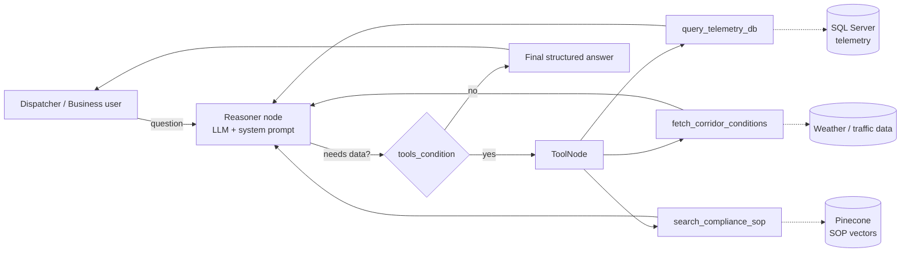

# 🧊 Cold-Chain Logistics: AI Dispatcher Agent

> Chat with your cold-chain data. A LangGraph-powered agent that investigates temperature anomalies and route disruptions by combining **live telemetry**, **external corridor conditions**, and **compliance SOPs**, then returns an action-oriented report for business stakeholders.


---

## 📌 Table of Contents

- [Overview](#-overview)
- [Key Features](#-key-features)
- [Architecture](#-architecture)
- [Tech Stack](#-tech-stack)
- [Project Structure](#-project-structure)
- [Getting Started](#-getting-started)
- [Configuration](#-configuration)
- [Usage](#-usage)
- [Agent Tools](#-agent-tools)
- [Output Format](#-output-format)
- [Switching LLM Providers](#-switching-llm-providers)
- [Troubleshooting](#-troubleshooting)
- [Roadmap](#-roadmap)
- [Author](#-author)

---

## 🔍 Overview

Cold-chain shipments (vaccines, food, pharma) fail when temperature drifts out of range or a route gets disrupted. Dispatchers normally have to check a telemetry database, look up weather and traffic, and then dig through SOP documents to decide what to do.

This project automates that workflow. A business user asks a plain-English question such as *"Is truck 5 okay?"* and the agent:

1. Queries the **telemetry database** for the vehicle's temperature and location.
2. Checks **external hazards** (weather, congestion) along the corridor.
3. Searches the **compliance SOP knowledge base** (Pinecone) for the rule that applies.
4. Replies with a structured **executive summary, analysis table, and action plan**.

---

## ✨ Key Features

- **Natural-language "chat with your data"** interface for non-technical stakeholders.
- **Tool-calling agent** built as a LangGraph state machine (reason → act → reason loop).
- **RAG over compliance SOPs** using Pinecone and local `BAAI/bge-m3` embeddings (1024-dim).
- **Pluggable LLM backend**: Groq, OpenAI, DeepSeek, or a local Ollama model, chosen with one env variable.
- **Conversation memory** per session through LangGraph's `MemorySaver` checkpointer.
- **Externalised system prompt** (`src/prompts/system_prompt.txt`), so behaviour can be tuned without touching code.
- **Fixed business output format** that is concise, analytical, and action-oriented.

---

## 🏗 Architecture



**How the graph works**

| Step | What happens |
| :--- | :--- |
| `START → reasoner` | The LLM receives the system prompt plus chat history and decides whether to call a tool. |
| `reasoner → tools` | If the LLM requested a tool call, `ToolNode` runs it. |
| `tools → reasoner` | Tool output goes back to the LLM, which can call more tools or answer. |
| `reasoner → END` | With no further tool calls, the final answer is returned. |

The system prompt is prepended on every LLM call inside `reasoning_node` and is **not** stored in the checkpointed history. This keeps history clean and works on providers (e.g. Qwen on Groq) that reject requests without a user message.

---

## 🧰 Tech Stack

| Layer | Technology |
| :--- | :--- |
| Language | Python |
| Agent orchestration | LangGraph, LangChain |
| LLM providers | Groq, OpenAI, DeepSeek, Ollama (local fallback) |
| Embeddings | `BAAI/bge-m3` via `sentence-transformers` / `langchain-huggingface` |
| Vector database | Pinecone (`langchain-pinecone`) |
| Relational database | SQL Server via `pyodbc` + SQLAlchemy |
| Data handling | pandas, openpyxl, pypdf, scikit-learn, FAISS (CPU) |
| UI (optional) | Streamlit |
| Tooling | `uv` (lockfile included), python-dotenv |

---

## 📁 Project Structure

```text
Cold-chain-logistics/
├── data/                  # Datasets used by the project
├── docs/                  # Documentation and SOP source material
├── scripts/               # Helper / ingestion scripts
├── src/
│   ├── orchestrator.py    # LangGraph agent + CLI chat loop
│   ├── agent_tools.py     # query_telemetry_db, fetch_corridor_conditions, search_compliance_sop
│   └── prompts/
│       └── system_prompt.txt   # Business-structured system prompt
├── main.py                # Placeholder entry point
├── pyproject.toml         # Project metadata and dependencies (uv)
├── requirements.txt       # Pinned dependencies (pip)
├── uv.lock                # uv lockfile
├── .python-version
└── .gitignore
```

---

## 🚀 Getting Started

### Prerequisites

- Python 3.12 or newer
- A SQL Server instance and the matching **ODBC driver** (needed by `pyodbc`)
- A **Pinecone** account and an index loaded with your SOP documents (1024 dimensions to match `bge-m3`)
- An API key for at least one LLM provider, **or** [Ollama](https://ollama.com) installed locally

### Installation

```bash
# 1. Clone the repository
git clone https://github.com/SaiprasadDash/Cold-chain-logistics.git
cd Cold-chain-logistics

# 2. Create and activate a virtual environment
python -m venv .venv
# Windows (PowerShell)
.venv\Scripts\Activate.ps1
# macOS / Linux
source .venv/bin/activate

# 3. Install dependencies
pip install -r requirements.txt
pip install langchain-groq        # needed when Agent_llm=GROQ

# (Alternative) using uv
uv sync
```

> If you plan to use local models, also run `pip install langchain-ollama` and `ollama pull qwen2.5:7b`.

---

## ⚙️ Configuration

Create a `.env` file in the project root:

```env
# --- LLM selection: GROQ | OPENAI | DEEPSEEK | OLLAMA (default) ---
Agent_llm=GROQ

# --- Embeddings (LOCAL uses BAAI/bge-m3) ---
Embeddings_model=LOCAL

# --- Provider keys (only the one you use is required) ---
GROQ_API_KEY=your_groq_key
OPENAI_API_KEY=your_openai_key
DEEPSEEK_API_KEY=your_deepseek_key

# --- Vector DB ---
PINECONE_API_KEY=your_pinecone_key

# --- Optional: avoids unauthenticated HuggingFace download warnings ---
HF_TOKEN=your_hf_token

# --- Telemetry database (adjust to match agent_tools.py) ---
# DB_SERVER=...
# DB_NAME=...
# DB_USER=...
# DB_PASSWORD=...
```

> ⚠️ Never commit `.env`. It is already covered by `.gitignore`; double-check before pushing.

---

## 💬 Usage

Run the interactive dispatcher console from the project root:

```bash
python src/orchestrator.py
```

You should see:

```text
🤖 Brain Mode: Utilizing Cloud Groq Reasoner ...
⚙️ Compiling LangGraph FDE Orchestrator...
🚀 FDE Supply Chain Orchestrator State Machine Online

Dispatcher >
```

Type a question, for example:

```text
Dispatcher > Why is truck 5 showing a temperature alert?
Dispatcher > Are any vehicles at risk on the northern corridor right now?
Dispatcher > What does the SOP say about a temperature excursion above 8°C?
```

Type `exit` or `quit` to stop.

While the agent works you will see `[System] 🔄 Retrieving external data elements via ToolNode...`, followed by the final answer.

---

## 🛠 Agent Tools

The agent can call three tools, defined in `src/agent_tools.py`:

| Tool | Purpose | Data source |
| :--- | :--- | :--- |
| `query_telemetry_db` | Fetch current temperature, location (lat/lon), and cargo status for a vehicle or shipment. Called **first**. | SQL Server (`pyodbc`) |
| `fetch_corridor_conditions` | Check weather and congestion hazards for the vehicle's location or route. Called **second**. | External conditions source |
| `search_compliance_sop` | Semantic search over SOP documents to find the rule that governs the detected anomaly. Called **third**. | Pinecone + `bge-m3` embeddings |

---

## 📊 Output Format

For shipment and anomaly questions, the agent answers in a fixed structure:

```markdown
### 1. Executive Summary
* Core anomaly or situation (1-2 sentences)
* Immediate operational risk

### 2. Telemetry & Environment Analysis
| Location (Lat/Lon) | Current Temp | Cargo Risk | Weather / Congestion |
| :--- | :--- | :--- | :--- |
| ...                | ...          | ...        | ...                  |

*Analysis:* Is the environment or the equipment causing the anomaly?

### 3. Required Action Plan
1. **Immediate step**: action derived from the SOP
2. **Immediate step**: action derived from the SOP

*SOP Compliance Citation:* Document and rule driving the plan
```

The format and tool order are controlled by `src/prompts/system_prompt.txt`.

---

## 🔄 Switching LLM Providers

Set `Agent_llm` in `.env`:

| Value | Model used | Extra requirement |
| :--- | :--- | :--- |
| `GROQ` | Qwen via Groq cloud | `GROQ_API_KEY`, `langchain-groq` |
| `OPENAI` | `gpt-4o` | `OPENAI_API_KEY` |
| `DEEPSEEK` | `deepseek-v4-flash` (OpenAI-compatible endpoint) | `DEEPSEEK_API_KEY` |
| anything else | Local `qwen2.5:7b` via Ollama | Ollama running locally |

---

## 🩺 Troubleshooting

| Problem | Cause | Fix |
| :--- | :--- | :--- |
| `400 ... No user query found in messages` | The LLM was invoked with only a system message. | Do not invoke the graph with just a `SystemMessage`. Prepend the system prompt inside `reasoning_node` (already done in this repo). |
| `HF Hub unauthenticated requests` warning | No HuggingFace token set. | Add `HF_TOKEN` to `.env`. It is a warning, not an error. |
| `pyodbc` import or connection errors | ODBC driver missing. | Install the Microsoft ODBC Driver for SQL Server. |
| Agent falls back to Ollama unexpectedly | `Agent_llm` missing or misspelled. | Check `.env` and the provider branches in `orchestrator.py`. |
| Pinecone dimension mismatch | Index not 1024-dim. | Recreate the index with dimension 1024 for `bge-m3`. |

---

## 🗺 Roadmap

- [ ] Streamlit web dashboard for dispatchers
- [ ] Real-time telemetry streaming and alerting
- [ ] Multi-vehicle fleet overview and route re-planning suggestions
- [ ] Evaluation suite for tool-call accuracy and SOP citation correctness
- [ ] Docker setup and CI pipeline

---

## 👤 Author

**Sai Prasad Dash**
GitHub: [@SaiprasadDash](https://github.com/SaiprasadDash)

---

## 📄 License

Add a license (for example MIT) to make reuse terms explicit.